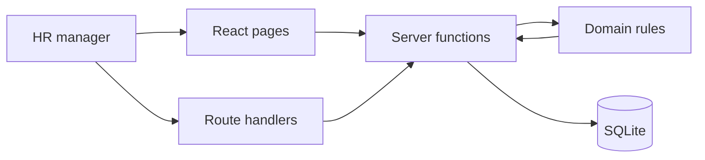

# Architecture

Paybook is a single Next.js application. The browser talks to React pages. Those pages and the JSON API call the same server functions. SQLite is the system of record.

## Layers

| Layer | Responsibility | Depends on |
| --- | --- | --- |
| `src/domain` | Money, dates, salary-change rules, workforce generation, aggregates | Nothing but itself |
| `src/db` | Schema, connection, seed | Domain generator |
| `src/server` | Directory queries, profile, pay change, insight queries | Domain and SQLite |
| `src/app` | Pages and HTTP | Server functions |
| `src/components` | Shell, salary form, tabbed breakdown | Pages pass data in |

Domain functions are pure. A salary change is planned in memory, then applied in one SQLite transaction. The UI cannot invent a second “current” salary: a partial unique index allows only one open record per employee.

## Record model

- `employees` — identity, country, current role, status.
- `salary_records` — annual amount in minor units, currency, effective window, reason.
- `fx_rates` — USD per one major unit of each currency, dated 2026-10-01.

Money is an integer of minor units (cents, paise). Floating point is used only for the published FX rate, and the product of that conversion is rounded back to an integer immediately.

## Request paths

- Pages read SQLite directly in server components. They do not call their own HTTP API.
- `/api/*` exists so the same behavior can be exercised with curl and covered by tests through the server functions.
- The first server start creates `data/acme.sqlite` and seeds it if the employee table is empty.

## How a pay change works

1. Parse the form into minor units and a known currency.
2. Load the employee and the open salary.
3. `planSalaryChange` either returns a close-and-insert plan or a reason to refuse.
4. A transaction sets `effective_to` on the open row and inserts the new row. If the level changed, the employee row is updated in the same transaction.

## Insights

The overview loads the open salary for every employee (10,000 rows) and aggregates in the domain layer. That keeps percentile math in one tested place. The directory never uses this path; it is filtered, ordered, and limited in SQL.

## Deployment shape

One Node process, one SQLite file on a persistent disk. See trade-offs for why this is not a serverless deployment.
